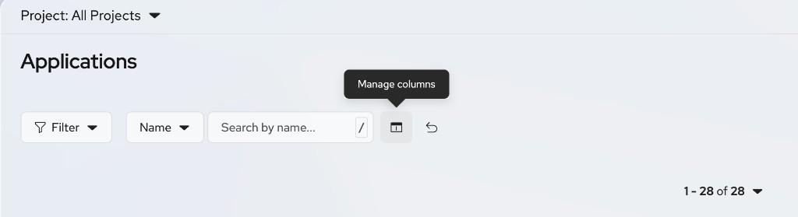
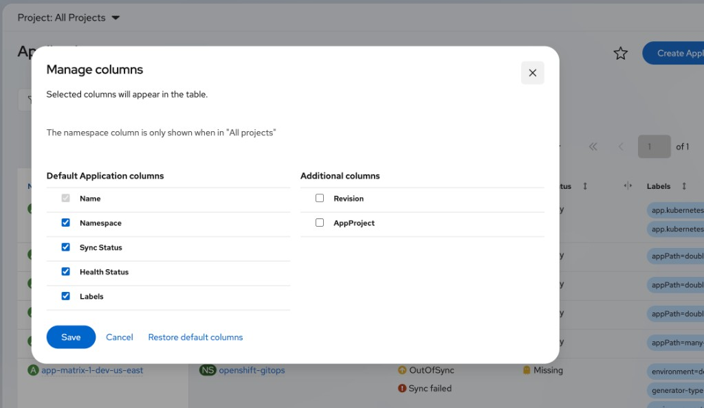
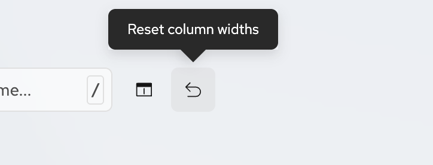

# Manage table columns

The GitOps Console plugin lets users choose which columns appear on resource tables and reset saved column widths. The console will auto save the last column choices and widths for when one last visited and can easily be restored to default by clicking the reset button.

These controls are available on the GitOps list pages for Applications, ApplicationSets, AppProjects, ImageUpdaters, and Rollouts. Some details tables also support the same controls.

## Prerequisites

* You have access to the OpenShift web console.
* The GitOps Console plugin is enabled.

## Manage columns

Use **Manage columns** to show or hide optional columns on a table.

1. In the OpenShift web console, navigate to **GitOps** and open a resource list page (or a details table that supports column management).

2. In the toolbar, click the **Manage columns** control (columns icon).

   

3. In the **Manage columns** dialog, select or clear columns under:
   * **Default** columns for that resource type
   * **Additional columns** (optional columns that are hidden by default)

   

4. Optional: Click **Restore default columns** to return the selection to the defaults for that table.

5. Click **Save** to apply the selection, or **Cancel** to discard changes.

> **NOTE**
>
> The **Name** column is locked and cannot be hidden. The **Namespace** column is available only when the **Project** dropdown is set to all projects. Selected columns appear in the table, and your choices are restored the next time you open that table.

Each resource page lists the columns that are available for that list, including which columns are shown by default and which are additional. See:

* [Applications in the GitOps Console](applications.md#table-columns)
* [ApplicationSets in the GitOps Console](applicationsets.md#table-columns)
* [AppProjects in the GitOps Console](appprojects-rbac.md#table-columns)
* [ImageUpdaters in the GitOps Console](image-updaters.md#table-columns)
* [Rollouts in the GitOps Console](rollouts.md#table-columns)

## Reset column widths

GitOps tables support resizable columns. Drag a column border to change its width. The console remembers the widths you set for that table.

To clear saved widths for the current table and restore the default layout:

1. Open the list or details table whose widths you want to reset.

2. In the toolbar, click **Reset column widths** (undo icon).

   

The table returns to the default column widths for that view. Column visibility set with **Manage columns** is not changed.
